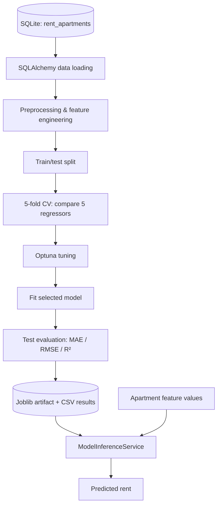

# Apartment Rent Prediction — ML Training & Inference

    

A modular Python machine learning application for **predicting apartment rental prices** from property characteristics. The project separates model training from inference, uses a SQLite data source, compares multiple regression algorithms, tunes hyperparameters with Optuna, and persists trained models and metadata for reuse.

> **Current scope:** This repository provides command-line training and inference entry points. It does **not** expose a REST API in its current version.

## Highlights

- **Database-backed training:** load apartment records from SQLite using SQLAlchemy.
- **Feature engineering:** one-hot encode categorical property attributes, extract garden values, and align the required feature columns.
- **Model selection:** compare five regression algorithms using five-fold cross-validation.
- **Hyperparameter optimization:** tune the selected model with Optuna.
- **Evaluation:** calculate MAE, RMSE, and R² on a held-out test set.
- **Artifact management:** save the fitted estimator, feature order, model name, best parameters, and test metrics in a Joblib artifact; export model comparison results to CSV.
- **Reusable inference:** load the artifact and predict from a defined set of apartment features.
- **Developer tooling:** Poetry, Makefile commands, Loguru, Flake8, and GitHub Actions.

## Architecture



Training and inference are separate **Python services/components**, not independently deployed network microservices.

## Technology stack

| Area | Technologies |
| --- | --- |
| Language & environment | Python 3.12, Poetry |
| Data | pandas, SQLite, SQLAlchemy |
| Machine learning | scikit-learn, XGBoost, LightGBM, CatBoost |
| Optimization | Optuna |
| Model serialization | Joblib |
| Configuration & logging | Pydantic Settings, Loguru |
| Quality & automation | Flake8, Make, GitHub Actions |
| Exploration | Jupyter notebooks, Plotly |

## Project structure

```text
.
├── .github/
│   ├── actions/build-application/action.yml   # Reusable CI setup
│   └── workflows/lint.yml                # Flake8 on push/PR to main
├── src/
│   ├── config/
│   │   ├── .env                         # Local settings (do not commit secrets)
│   │   ├── db.py                        # Database settings and engine
│   │   ├── logger.py                    # Loguru configuration
│   │   └── model.py                     # Model settings
│   ├── db/
│   │   ├── db.sqlite                    # SQLite training data
│   │   └── db_model.py                  # SQLAlchemy ORM model
│   ├── model/
│   │   ├── pipeline/
│   │   │   ├── collection.py            # Database ingestion
│   │   │   ├── preparation.py           # Feature preparation
│   │   │   └── model.py                 # Training, selection, evaluation, saving
│   │   ├── model_builder.py             # Training service
│   │   ├── model_inference.py           # Prediction service
│   │   └── models/                    # Saved model and comparison CSV
│   ├── jupyter_notebooks/              # Model experiments
│   ├── logs/                           # Application logs
│   ├── runner_builder.py               # Training entry point
│   └── runner_inference.py             # Inference entry point
├── Makefile
├── pyproject.toml
├── poetry.lock
└── setup.cfg
```

## Getting started

### Prerequisites

- **Python 3.12** (the project requires `>=3.12,<3.13`)
- **Poetry** installed and available on your `PATH`
- A working SQLite database at `src/db/db.sqlite`, with the expected `rent_apartments` table, to retrain the model

### Installation

```bash
git clone https://github.com/el-tka/ml-app.git
cd ml-app
poetry install
```

If using a different repository URL or directory name, adjust the clone command accordingly.

### Configuration

Settings are loaded through Pydantic Settings from `src/config/.env`. The code currently resolves several paths **relative to the process working directory**, so launch the runners from `src/`.

Example `src/config/.env`:

```dotenv
model_output_path="model/models"
model_results_path="models_results"
model_name="best_boosting_model_db_v1.joblib"
model_results_name="boosting_comparison.csv"
log_level="INFO"
connection_string="sqlite:///db/db.sqlite"
rent_apartments_table_name="rent_apartments"
random_state=42
```

The model output directory must exist before model settings are loaded (`DirectoryPath` validation). The repository contains `src/model/models/` already. Keep local `.env` files and credentials out of version control.

### Train the model

From the repository root, run:

**PowerShell:**

```powershell
cd src
poetry run python runner_builder.py
cd ..
```

**Bash:**

```bash
cd src
poetry run python runner_builder.py
cd ..
```

This workflow loads the database, prepares features, compares regressors, optimizes the winning model, evaluates it, and saves the model artifact and comparison CSV.

### Run inference

From the repository root:

```powershell
cd src
poetry run python runner_inference.py
cd ..
```

The runner loads the saved model and predicts the rental price for the example apartment specified in `src/runner_inference.py`. Results are written to the configured log file.

### Makefile shortcuts

The repository also provides these targets (run from the project root in an environment with `make` available):

```bash
make install            # Install Poetry dependencies
make check              # Run Flake8
make run_builder        # Install dependencies, then train
make run_inference      # Install dependencies, then infer
make runner_builder     # Lint, train, clean
make runner_inference   # Lint, infer, clean (default target)
make clean              # Remove Python __pycache__ directories
```

On Windows, `make` is not included with PowerShell by default; the direct Poetry commands above work without it.

## Machine learning pipeline

### Input features

The model uses **nine** numeric features in the following order:

| Feature | Meaning |
| --- | --- |
| `area` | Apartment area |
| `constraction_year` | Year of construction (spelling preserved from the code) |
| `bedrooms` | Number of bedrooms |
| `garden` | Numeric garden attribute |
| `balcony_yes` | Encoded balcony indicator |
| `parking_yes` | Encoded parking indicator |
| `furnished_yes` | Encoded furnishing indicator |
| `garage_yes` | Encoded garage indicator |
| `storage_yes` | Encoded storage indicator |

**Target:** `rent` — rental price from the training dataset. The currency and billing period are not specified in the source code, so predictions should be interpreted in the dataset's original units.

### Training steps

1. Read apartment data from the configured SQLite database.
2. One-hot encode `balcony`, `parking`, `furnished`, `garage`, and `storage`; parse the numeric `garden` value and ensure required feature columns exist.
3. Split into **80% training / 20% test** with `random_state=42`.
4. Impute missing feature values with training-set medians (falling back to zero).
5. Compare **Random Forest, Gradient Boosting, XGBoost, LightGBM, and CatBoost** using shuffled five-fold cross-validation.
6. Select the candidate with the lowest average cross-validation **RMSE**.
7. Tune the selected algorithm using **Optuna**, then fit and evaluate it on the test set.
8. Save the trained artifact and a CSV summary of the candidate comparison.

The model artifact includes:

```python
{
    "model": fitted_estimator,
    "model_name": selected_algorithm_name,
    "features": feature_names_in_order,
    "best_params": optuna_best_parameters,
    "test_metrics": evaluation_metrics,
}
```

The actual values are generated during training. This README does not invent benchmark scores or claim a particular model always wins.

### Output files

| File | Purpose |
| --- | --- |
| `src/model/models/best_boosting_model_db_v1.joblib` | Trained estimator and metadata |
| `src/model/models/models_results/boosting_comparison.csv` | Cross-validation comparison |
| `src/logs/app.log` | Application logs |

Loguru is configured with daily rotation, two-day retention, and ZIP compression for rotated logs.

## Prediction example

`ModelInferenceService` expects a **positional list** in the feature order stored in the artifact:

```python
from model.model_inference import ModelInferenceService

service = ModelInferenceService()
service.load_model()

features = [
    100,   # area
    2000,  # constraction_year
    3,     # bedrooms
    0,     # garden
    0,     # balcony_yes
    0,     # parking_yes
    0,     # furnished_yes
    0,     # garage_yes
    0,     # storage_yes
]

prediction = service.predict(features)
print(prediction[0])
```

Run this example with `src/` as the working directory and the dependencies installed. The model must already exist at the configured path. The inference service **does not automatically retrain** a missing model.

> **Feature-order warning:** Input values must match the order of `artifact["features"]`. Passing values in a different order can produce incorrect predictions without an obvious error.

## Logging and CI

- **Logging:** `src/config/logger.py` configures Loguru to write to `logs/app.log` relative to the runner's working directory. With the documented `src/` launch directory, that means `src/logs/app.log`.
- **CI:** `.github/workflows/lint.yml` runs on pushes and pull requests targeting `main`, sets up Python 3.12.10 and Poetry, caches the virtual environment, and runs `poetry run flake8 src/`.
- **Lint settings:** `setup.cfg` defines Flake8 exclusions and project-specific ignored rules.

**CI currently checks linting only.** Automated tests, coverage, container builds, and deployment are not configured in this archive.

## Known limitations and roadmap

- [ ] Add a Flask or FastAPI HTTP inference endpoint, with request validation and documented JSON examples.
- [ ] Add unit/integration tests for preprocessing, artifact loading, and predictions.
- [ ] Use absolute paths derived from project files rather than the current working directory.
- [ ] Add explicit inference input validation and safe feature-name alignment.
- [ ] Persist preprocessing/imputation with the estimator for more robust training–serving consistency.
- [ ] Add Docker packaging, health checks, and deployment instructions.
- [ ] Add model versioning and monitoring for production use.
- [ ] Exclude generated logs, model experiments, and sensitive data from Git as appropriate; review already tracked files separately.

## Author

**Elena Skvortsova** — Data Science / Machine Learning Engineering

GitHub: [@el-tka](https://github.com/el-tka)

---

*This README documents the implementation included in the supplied project archive; planned features are explicitly distinguished from implemented ones.*
